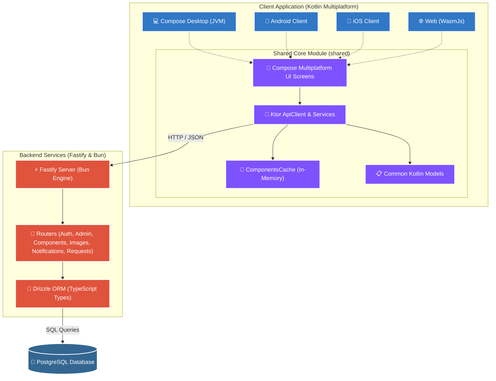
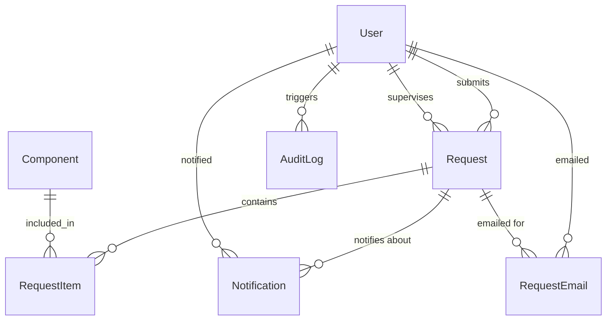

# 🎓 IIITNR Inventory App

[](https://github.com/sharifmdathar/iiitnr-inventory-app/releases)
[](https://github.com/sharifmdathar/iiitnr-inventory-app/releases)
[](https://www.codefactor.io/repository/github/sharifmdathar/iiitnr-inventory-app)


[](https://kotlinlang.org/docs/multiplatform.html)
[](https://fastify.dev/)
[](https://bun.sh/)
[](https://orm.drizzle.team/)
[](https://github.com/JetBrains/compose-multiplatform)
[](https://kotlinlang.org/docs/wasm-overview.html)
[](LICENSE)

An **Inventory & Item Issue-Return Management System** for the **International
Institute of Information Technology, Naya Raipur (IIITNR)**. Students request
lab components under a faculty supervisor's approval, get them scanned out and
back in by QR code, and the system tracks stock, due dates, renewals and an
immutable audit trail for every action.

The client is a cross-platform **Kotlin Multiplatform / Compose Multiplatform**
app (Android, Desktop, iOS, Web) talking to a **Fastify + Bun + Drizzle ORM +
PostgreSQL** backend.

---

## 📥 Download App

Get the latest version of the IIITNR Inventory App for your device:

- **🚀 Smart Link:** [Download for your OS](https://inventory.iiitnr.ac.in/download) (Auto-detects Platform)
- **Android:** [Download APK](https://inventory.iiitnr.ac.in/download/android)
- **Windows:** [Download EXE](https://inventory.iiitnr.ac.in/download/windows)
- **Linux:** [Download AppImage](https://inventory.iiitnr.ac.in/download/linux)

For all other versions and full release history, visit the [GitHub Releases](https://inventory.iiitnr.ac.in/download).

---

## 📺 Demo Video

[](https://youtu.be/MgsA0b5uwyU)

---

## 📌 Table of Contents

- [✨ Key Features](#-key-features)
- [🏗️ System Architecture](#️-system-architecture)
- [🛠️ Tech Stack & Dependencies](#️-tech-stack--dependencies)
- [🚀 Quick Start & Development Setup](#-quick-start--development-setup)
  - [Prerequisites](#prerequisites)
  - [Backend Setup](#backend-setup)
  - [Kotlin Multiplatform App Setup](#kotlin-multiplatform-app-setup)
- [🧰 Justfile Task Runner Cheatsheet](#-justfile-task-runner-cheatsheet)
- [📚 Further Documentation](#-further-documentation)

---

## ✨ Key Features

### 👤 Role-Based Auth & Profiles (RBAC)
- **Multi-Role Matrix:** Features strict role-based verification supporting five tiers: `STUDENT`, `LA` (Lab Assistant), `FACULTY`, `ADMIN`, and `PENDING`.
  - **`ADMIN`:** Full access across the system — component CRUD & images, request fulfillment/lifecycle, user management (search users, change roles/batches/branches), and exclusive access to the immutable audit log ledger.
  - **`LA` (Lab Assistant):** Inventory operations & request fulfillment — component CRUD & images, QR-code scanning, issuing/partially issuing approved requests, returning/partially returning items, and exporting CSV data.
  - **`FACULTY`:** Component catalog viewing & CSV export, supervision and approval/rejection of student project requests and renewal requests nominated to them.
  - **`STUDENT`:** Component catalog browsing, submitting item issue and renewal requests nominated under faculty supervisors, and tracking/retracting personal requests.
  - **`PENDING`:** New registrations awaiting administrator role verification.
- **Automatic Batch/Branch Derivation:** Student batch (graduation range, e.g., `2024-2028`) and branch (`CSE`, `ECE`, `DSAI`) are derived automatically from their institutional email address during signup or profile fetches.
- **Domain Gatekeeping:** Restricts registration/login to IIITNR emails via `ALLOWED_EMAIL_DOMAIN` configuration (e.g., `@iiitnr.edu.in`), protecting college resources.
- **User Management Panel:** Provides administrators with a user panel to search registered accounts and update user details (names, roles, batches, and branches).

### 📦 Lab & Component Catalog Management
- **Hierarchical Layout:** Components organized by categories (`Sensors`, `Actuators`, `Microcontrollers`, `Microprocessors`, `Others`).
- **Real-time Stock Auditing:** Separates `totalQuantity` from `availableQuantity` dynamically, updating automatically as items are requested, approved, and returned.
- **Cross-Platform Image Workflow:** Component images can be selected on Android, Desktop, and iOS, uploaded to the backend, and recorded in the audit log when they change.
- **Upload Guardrails:** Image uploads are restricted to common formats (`JPEG`, `PNG`, `WEBP`, `GIF`, `AVIF`) and capped at `10 MB`.
- **Platform-Native Data Export:** Built-in tool to export the component database to a CSV file from the client top bar (uses platform-specific storage on Android and Desktop).

### 🔄 Multi-State Issue, Return & Renewal System
- **Project Nominated Issues:** Students issue items under specific project titles and name a nominating `FACULTY` supervisor.
- **Resumable Drafts:** The request a student is assembling is kept on the device, so a restart, a crash or an app killed in the background never loses the selected items, quantities, project title or supervisor.
- **QR-Based Fulfillment:** Admins and LAs can fulfill and return requests instantly by scanning a student's unique Request QR code.
- **Fulfillment & Due Tracking:** Approved requests are fulfilled by admins/LAs, automatically setting a 30-day return due date (`returnDueAt`).
- **Auto-Expiry:** Fulfilled or renewed requests past their `returnDueAt` are automatically marked `EXPIRED` by a periodic background sweep.
- **Request Renewals:** Students can submit renewal requests with a detailed reason, allowing nominating faculty or admins/LAs to extend the due date by another 30 days.
- **Automatic Stock Restocking:** Returning components automatically increments `availableQuantity` on the backend, checking against `totalQuantity`.
- **Partial Issue & Return:** Admins/LAs can issue/return specific quantities per item when stock is limited or partial returns occur. Requests track `fulfilledQuantity` per item with `PARTIALLY_ISSUED` and `PARTIALLY_RETURNED` statuses, enabling multi-step fulfillment and granular inventory control.
- **Expiry Write-Off:** Items that are still outstanding when a request expires are written off the component stock in the same transaction, and the adjustment is recorded in the audit log.
- **Notifications:** Every request event (submission, approval, issue, return, expiry, renewal) raises an in-app notification for the student, the faculty supervisor and the lab staff.
- **Email Reminders:** An optional SMTP integration emails the student a reminder 7 days before the return due date, chases the nominating faculty member when a renewal request goes unanswered, notifies the lab when a request expires and stock is written off, and reports the late-return charge on a day 1/3/7/14/30 ladder.

### 🛡️ Enterprise-Grade Admin Audit Logging
- **Admin-Exclusive Immutable Ledger:** Records all system activities like `CREATE`, `UPDATE`, `DELETE`, `LOGIN`, `LOGOUT`, `REQUEST_STATUS_CHANGE`, and `INVENTORY_ADJUST`. Only Administrators have permission to query and view audit logs.
- **System-Wide Accountability:** Stores state changes using highly detailed diffs (`oldValues` and `newValues`), tracking IP addresses, and user-agent details for advanced security audits.

### 🔄 Automatic Version Compatibility Check
- **Synchronized Deployments:** Startup compatibility check that calls the server version endpoint (`GET /version`), matching it using semantic version comparisons.
- **In-App Upgrades:** Displays a Snackbar banner to download updates from the GitHub Releases page if a newer server version is detected.

---

## 🏗️ System Architecture

The application is structured into a modern decoupled architecture. The frontend application shares Core logic, models, and network API layer across all targets (Desktop, Android, and iOS) via Kotlin Multiplatform, and connects over HTTP/JSON with the Fastify/PostgreSQL backend server.



---

## 🗄️ Database Schema & Entities

<!-- BEGIN GENERATED: schema-relations -->

<!-- END GENERATED: schema-relations -->

Regenerate both after changing the schema:

```bash
just gen-schema
```

---

## 🔄 Issue & Return Request Lifecycle

A request moves through an automated state machine — `PENDING` → `APPROVED` →
`ISSUED` / `PARTIALLY_ISSUED` → `RETURNED` / `PARTIALLY_RETURNED`, with
`REQUESTED_RENEW` / `RENEWED` for extensions and `EXPIRED` when the due date
passes without a full return.

The complete diagram, the status reference and the background sweeps that drive
expiry and renewal reminders are in
[docs/request-lifecycle.md](docs/request-lifecycle.md).

---

## 🛠️ Tech Stack & Dependencies

### Backend Engine (`/backend`)
*   **Runtime:** [Bun Runtime](https://bun.sh/) (Extremely fast JavaScript/TypeScript runtime)
*   **Web Framework:** [Fastify 5](https://fastify.dev/) (High-performance API server framework)
*   **ORM:** [Drizzle ORM](https://orm.drizzle.team/) (Next-generation type-safe database layer)
*   **Database:** PostgreSQL (Robust and secure relational store)
*   **Security & Protection:** 
    *   `@fastify/helmet` for secure HTTP headers.
    *   `@fastify/rate-limit` for rate limiting (100 requests per minute by default).
    *   `xss` for cross-site scripting input protection.
    *   `bcryptjs` for strong password hashing.
    *   `@fastify/jwt` for stateless JSON Web Token session auth.
    *   `google-auth-library` to securely verify Google OAuth sign-in tokens.
*   **Logging:** `pino-pretty` for structured, beautiful developer logs.
*   **Email:** `nodemailer` over SMTP for the optional expiry / renewal reminder emails.
*   **Testing:** Native `bun test` runner.

### Kotlin Multiplatform Client (`/app`)
*   **Target Core Architecture:** Clean Architecture separating UI, Presentation, API, Cache, and Storage.
*   **UI Engine:** Jetpack Compose Multiplatform (UI codebase shared across all targets).
*   **Navigation:** `androidx.navigation.compose` for unified screen graph routing.
*   **Networking:** [Ktor HTTP Client](https://ktor.io/) with `ContentNegotiation` and `kotlinx.serialization` for robust type-safe API requests.
*   **Local Caching:** Dedicated `ComponentsCache` for lightning-fast search queries.
*   **Request Draft:** A `DraftCache` keeps the request a student is putting together — items, quantities, project title and supervisor — in the local SQLDelight database, so it survives a restart or a killed app. Drafts are stored per user and clamped to the stock that is available when they are restored.
*   **Token Store:** `TokenManager` for persistent JWT handling.
*   **Static Code Analysis:** Kotlin `detekt` static analyzer & `ktlint` formatter checks.

---

## 🚀 Quick Start & Development Setup

### Prerequisites
Make sure you have the following installed on your developer machine:
- [Bun Runtime](https://bun.sh/) (v1.3.11+)
- [Java Development Kit (JDK) 17+](https://adoptium.net/temurin/releases/) (Required for KMP compilation)
- [Podman](https://podman.io/) or [Docker](https://www.docker.com/) (For launching the database)
- [Just](https://github.com/casey/just) task runner (Optional, but highly recommended)

For the client targets you also need: **Android Studio** (with a device or
emulator) for Android, **Xcode** on macOS for iOS, and the **Android SDK
platform tools** (`adb`) for `just andro`.

---

### Backend Setup

1. **Navigate to the Backend directory:**
   ```bash
   cd backend
   ```

2. **Install Dependencies:**
   ```bash
   bun install
   ```

3. **Configure Environment Variables:**
   Copy `backend/.env.example` and fill in the blanks:
   ```bash
   cp backend/.env.example backend/.env
   ```

   **Required** — the backend will not start without these:

   | Variable | Purpose |
   |---|---|
   | `JWT_SECRET` | Signs auth tokens — generate with `openssl rand -hex 32` |
   | `DATABASE_URL` | PostgreSQL connection string — set this when pointing at an existing database |
   | `DB_USER` + `DB_PASSWORD` | **Alternative to** `DATABASE_URL` (if want to use local postgres DB with compose)


4. **Spin up a local PostgreSQL Instance (via Podman Compose):**
   ```bash
   just db-up
   ```

5. **Generate & Apply Database Migrations:**
   ```bash
   bun run migrate
   ```

6. **Create the Initial Admin User:**
   ```bash
   bun run seed
   ```
   The seed script creates one `ADMIN` account. The password is printed to the
   console — it is generated randomly unless `ADMIN_PASSWORD` is set in `.env`.

7. **Start the API Server (Development Mode):**
   ```bash
   just dev
   ```
   The backend API will be available at `http://localhost:4000`.

---

### Kotlin Multiplatform App Setup

The frontend app shares the core UI and logic in `app/shared`, while platform specific runners exist for Desktop, Android, and iOS.

#### 1. Running the Compose Desktop Client
You can run the Desktop application immediately using the preconfigured gradle task:
```bash
cd app
./gradlew desktop:run
```
*(Or simply run `just desk` from the project root)*

#### 2. Running the Android Client
Open the `app` directory in **Android Studio**. Make sure the target emulator or physical device is connected, and select the `android` module configuration and click **Run**.

*Note: the Android **debug** build points at the hosted backend
(`app/shared/src/androidMain/.../DevBaseUrl.android.kt`), while the desktop and
web debug builds point at `http://localhost:4000`. To use a local backend from
an Android emulator, change `devBaseUrl()` to `http://10.0.2.2:4000` — that is
how the emulator reaches the host machine.*

*Or from the command line, with a device connected via adb:*
```bash
just andro
```

#### 3. Running the iOS Client
Prerequisites: macOS with Xcode installed. Open the `/app/iosApp` project workspace inside Xcode, configure your developer certs, select a simulated iOS device, and press **Cmd + R**.

#### 4. Running the Web (WasmJs) Client
You can run the Web application in development mode with hot-reload:
```bash
cd app
./gradlew :web:wasmJsBrowserDevelopmentRun
```
*(Or simply run `just web` from the project root)*

---

## 🧰 Justfile Task Runner Cheatsheet

If you have `just` runner installed, you can use the following shortcuts from the **root** of the repository. Run `just` on its own for the default `dev` task, or `just --list` to see every available recipe.

**Local development & quality**

| Command | Action Description | Target Component |
| :--- | :--- | :--- |
| `just install` | Installs backend node modules using `bun` | Backend |
| `just dev` | Runs the database migrations and boots the backend in watch mode | Backend |
| `just db-up` | Starts a PostgreSQL instance using Compose | Database |
| `just db-down` | Tears down the PostgreSQL Compose instance | Database |
| `just up` / `just down` | Spins up/down the complete Podman Compose stack | Full Stack |
| `just logs` | Follows logs from the compose container stack | Diagnostics |
| `just test` | Launches database and executes the backend test suite | Quality / CI |
| `just desk` | Compiles and launches the desktop app locally | Compose Desktop |
| `just andro` | Builds the debug APK and installs it on the connected device | Compose Android |
| `just web` | Launches the Kotlin WasmJs web application | Compose Web |
| `just lint` | Runs eslint on backend and ktlint checks on client | Quality / Checks |
| `just lint-fix` | Formats both backend source files and Kotlin source files | Formatters |
| `just typecheck` | Validates TypeScript configuration and resolves type-errors | Backend TypeScript |
| `just fmt` | Prettifies backend and client files | Formatters |
| `just detekt` | Runs deep static code quality analysis on KMP project | Quality Client |

**Deployment & releases** — these affect production and are for maintainers only

| Command | Action Description |
| :--- | :--- |
| `just deploy-web` | Builds the web client and publishes it to `/srv/web` |
| `just deploy` | Pulls the latest commit, redeploys the web app and rebuilds the backend container |
| `just release <version>` | Pushes to `main` and creates a GitHub release with generated notes |
| `just push` | Typechecks, tests and runs detekt before pushing to the remote |

---

## 📚 Further Documentation

| Document | What it covers |
| :--- | :--- |
| [docs/schema.md](docs/schema.md) | The full entity-relationship diagram — **generated** from the Drizzle schema |
| [docs/request-lifecycle.md](docs/request-lifecycle.md) | The request state machine, status reference and the background sweeps |
| [docs/deployment.md](docs/deployment.md) | Production topology, environment variables and the deploy procedure |
| [docs/troubleshooting.md](docs/troubleshooting.md) | Common failures and how to fix them |

**Contributing:** run `just push` before opening a pull request — it typechecks,
runs the test suite and the Kotlin static analysis, the same gates CI enforces
on every pull request.

---

*Made with ❤️ for IIIT Naya Raipur.*
