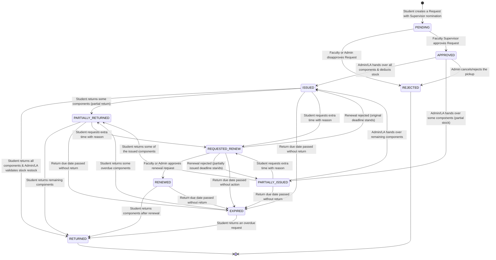

# Issue & Return Request Lifecycle

The system tracks a component request through an automated state machine, from
submission to final return. The source of truth is the `RequestStatus` enum in
`backend/src/utils/enums.ts` and the transition logic in
`backend/src/services/RequestService.ts` — this page documents it.

## Status reference

| Status | Meaning |
|---|---|
| `PENDING` | Submitted, waiting for the nominating faculty member to approve |
| `APPROVED` | Approved, waiting for the lab to hand the items over |
| `REJECTED` | Disapproved — terminal |
| `ISSUED` | All items handed over; `returnDueAt` is set 30 days ahead |
| `PARTIALLY_ISSUED` | Some items handed over; the rest are still pending |
| `PARTIALLY_RETURNED` | Some items returned, others still outstanding |
| `RETURNED` | All items returned and restocked — terminal |
| `EXPIRED` | The due date passed without a full return |
| `REQUESTED_RENEW` | The student asked for more time, with a reason |
| `RENEWED` | The renewal was approved; the due date moved forward by 30 days |

## Key behaviours

- **Return window** — `returnDueAt` is set 30 days after fulfilment
  (`REQUEST_RETURN_LIMIT_MS` in `backend/src/services/request-expiry.ts`).
- **Expiry sweep** — a background job runs hourly
  (`REQUEST_EXPIRY_SWEEP_INTERVAL_MS`) and marks overdue requests `EXPIRED`.
  It writes the outstanding quantity off the component stock in the same
  transaction, and records an `INVENTORY_ADJUST` audit entry per component.
- **Renewal** — a renewal extends the due date by another 30 days. The last
  renewal date and reason are kept on the request.
- **Renewal reminder** — a separate hourly sweep emails the student 7 days
  before the due date. `renewalReminderSentAt` guarantees it is sent only once
  per request.
- **Renewal chase** — `renewalRequestedAt` records when a renewal was asked
  for. If the nominating faculty member has not acted after 2 days (and again
  after 7), they are emailed. Nobody else is contacted.
- **Partial fulfilment** — every `RequestItem` tracks `quantity`,
  `fulfilledQuantity`, `returnedQuantity` and `writtenOffQuantity`, so stock
  stays correct across partial issues, partial returns and expiry write-offs.

## Notifications

Every request event also produces an in-app notification, stored in the
`Notification` table and shown in the client:

| Event | Notification type |
|---|---|
| Request submitted | `REQUEST_SUBMITTED` (to the faculty supervisor and to staff) |
| Request approved / rejected | `REQUEST_APPROVED`, `REQUEST_REJECTED` |
| Items issued / partially issued | `ISSUED`, `PARTIALLY_ISSUED` |
| Items returned / partially returned | `RETURNED`, `PARTIALLY_RETURNED` |
| Request expired | `REQUEST_EXPIRED` (to the student, the supervisor and staff) |
| Renewal requested / approved / rejected | `RENEWAL_REQUESTED`, `RENEWAL_APPROVED`, `RENEWAL_REJECTED` |

## Emails

Outbound **email** is optional and needs the SMTP variables to be configured
(see [troubleshooting](troubleshooting.md#email)). When it is set up, the
backend sends the following:

| Trigger | Recipient | Subject |
|---|---|---|
| 7 days before the return due date | the student | `Reminder: Return due for "<project>" on <date>` |
| A renewal request has been waiting 2 days | the nominating faculty member | `Action needed: renewal request for "<project>" is still pending` |
| … and still waiting after 7 days | the nominating faculty member | the same subject, one follow-up only |
| The request expired | the student, the nominating faculty member, and the lab staff (`ADMIN` + `LA`) | `Your request "<project>" has expired` / `Request expired: "<project>"` / `Inventory write-off: "<project>"` |
| 1, 3, 7, 14 and 30 days overdue | the student | `Overdue: ₹N accrued on "<project>"` |

Every email is recorded in the `RequestEmail` table, which is also what
prevents a duplicate: a unique index over
`(requestId, recipientId, kind, variant)` makes a second identical email
impossible. The row is only written after a successful send, so a temporary
SMTP failure is retried by the next sweep.

Only the student is told about the late-return charge — the faculty and the
staff are told about the write-off, not about the money.

## Late return charge

- A request that is overdue by at least one day accrues **₹1 per day**, capped
  at **₹30** — one full return period. The accrued amount is kept on
  `Request.lateFeeAccrued` and exported in the requests CSV.
- The charge starts on the day after the return due date and stops when
  everything is back (`Request.returnedAt` is set).
- The student is emailed on a fixed ladder — day 1, 3, 7, 14 and 30 — rather
  than daily. A request therefore produces at most five charge emails, and
  each one quotes the total accrued so far.

