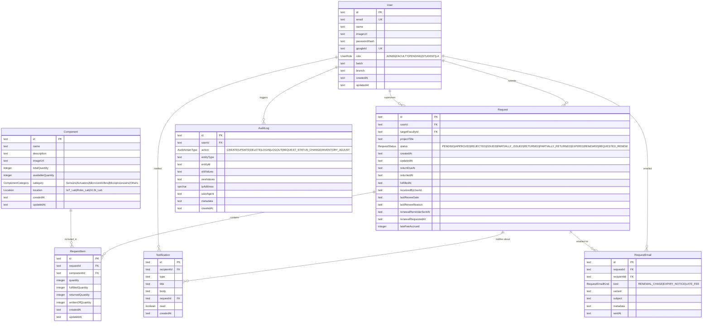

# Database Schema & Entities

The PostgreSQL schema is powered by [Drizzle ORM](https://orm.drizzle.team/). The
diagram below is **generated from `backend/src/drizzle/schema.ts`** — regenerate it
with:

```bash
just gen-schema
```

> [!WARNING]
> This file is generated. Do not edit it by hand — change the schema in
> `backend/src/drizzle/schema.ts` and run the generator again. CI fails if this
> page is out of date.



## Notes

- The legacy `_prisma_migrations` table is excluded: it is a leftover from the
  Prisma era and is not part of the application domain.
- `writtenOffQuantity` on `RequestItem` tracks stock that was issued but never
  returned before a request expired. It is subtracted from `Component.totalQuantity`
  but not from `availableQuantity` (the stock was already deducted at issue time).
- `renewalReminderSentAt` on `Request` guarantees the 7-day renewal reminder
  email is sent exactly once per request.
- `Notification` rows are the in-app notification feed; `read` drives the unread
  badge in the client.
